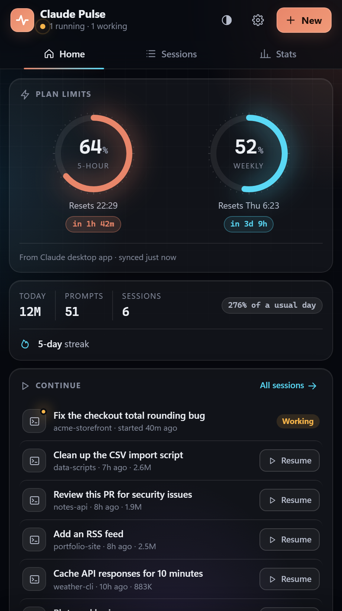
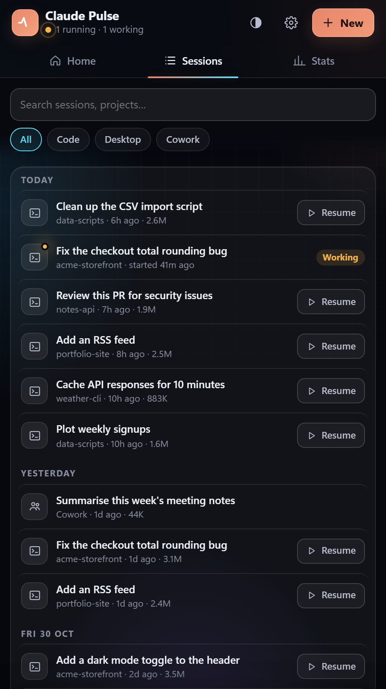
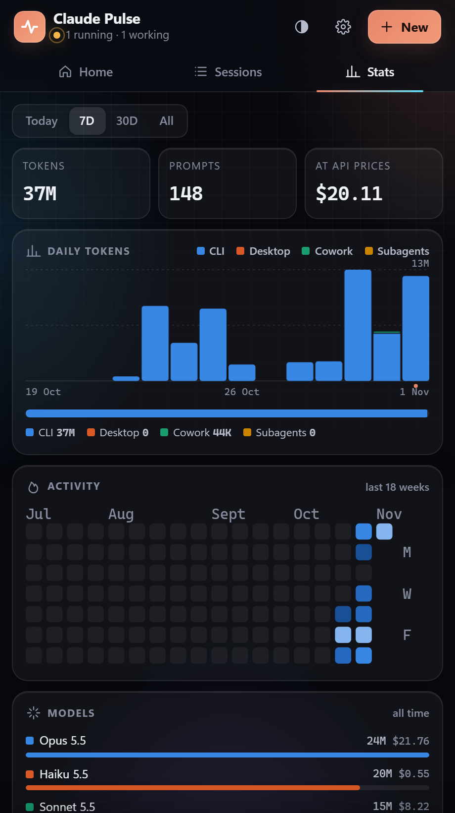

# Claude Pulse

A small desktop dashboard for your Claude usage: plan limits with reset times, every Claude Code / Desktop / Cowork session with one-click resume, and stats on tokens, models, projects and tools. Works on Windows, macOS and Linux. Everything stays on your computer.

<p>
  
  
  
</p>

## Install with Claude (easiest)

Copy this repo's link and paste it into Claude Code with:

> Install this for me: https://github.com/ravirahul/claude-pulse

Claude follows [the steps below](#install-steps-for-claude).

## Install by hand

You need [Node.js](https://nodejs.org) 18 or newer and git.

**Windows** (PowerShell):
```powershell
git clone https://github.com/ravirahul/claude-pulse "$env:LOCALAPPDATA\claude-pulse"
powershell -ExecutionPolicy Bypass -File "$env:LOCALAPPDATA\claude-pulse\build.ps1"
```

**macOS / Linux**:
```sh
git clone https://github.com/ravirahul/claude-pulse ~/.local/share/claude-pulse
sh ~/.local/share/claude-pulse/install.sh
```

**Update:** Settings (gear) > About > Check for updates > Update now. Pulse also checks GitHub twice a day and shows "Update available" in the footer. By hand: `git pull` in the install folder, then run the same install command again.
**Uninstall:** Windows: tray > Quit, then delete the folder and the "Claude Pulse" shortcuts in Start Menu and Startup. macOS / Linux: `sh install.sh --uninstall`, then delete the folder.

## Install steps (for Claude)

If a user gave you this repo's link and asked you to install it:

1. Check `node -v` is 18 or newer. If Node is missing or older, ask the user to install it from nodejs.org (or offer the platform's package manager: `winget install OpenJS.NodeJS.LTS`, `brew install node`, or the Linux distro's package) and stop until they have.
2. Clone the repo. If the folder already exists, `git pull` there instead.
   - Windows: `%LOCALAPPDATA%\claude-pulse`
   - macOS / Linux: `~/.local/share/claude-pulse`
3. Run the installer from that folder:
   - Windows: `powershell -ExecutionPolicy Bypass -File build.ps1` (add `-NoStartup` only if the user doesn't want it to start with Windows). It compiles the tray app with the C# compiler built into Windows, adds Start Menu + Startup shortcuts, and opens the window.
   - macOS / Linux: `sh install.sh`. It registers a login service (launchd on macOS, systemd user service on Linux), adds a "Claude Pulse" app (~/Applications on macOS, the app menu on Linux) and opens the window.
4. Check it is running: `curl -s http://127.0.0.1:47821/api/settings` should return JSON. The first index of a large history can take a minute.
5. Tell the user how to open it (below) and that live plan limits and phone access are off until they turn them on in Settings (gear icon).

## Using it

- **Open:** Windows: click the tray icon or press **Ctrl+Alt+P**. macOS: Applications / Spotlight > Claude Pulse. Linux: app menu > Claude Pulse. Or visit http://127.0.0.1:47821 in any browser.
- **New session:** the **New** button (or **N**). **Resume** from Home, the Sessions tab, or (Windows) tray > Resume. Sessions open in a new terminal window: Windows Terminal / console on Windows, Terminal.app on macOS, your terminal on Linux.
- **Settings (gear):** theme, live plan limits, limit alerts, phone access.

### Tabs
- **Home:** plan limits with reset countdowns, today so far, running + recent sessions, one rotating insight.
- **Sessions:** every Code, Desktop and Cowork session, searchable and grouped by day.
- **Stats:** daily tokens, activity heatmap, models, projects, hours, subagents, skills, tools. Costs are at API list prices, for comparison only.

### Plan limits
- **Off (default):** percentages from the Claude desktop app's last sync, if you use the desktop app. The weekly reset is projected from Cowork's rate-limit events. The 5-hour reset is shown only when known exactly.
- **Live (opt-in):** polls the same endpoint Claude Code's `/usage` uses, every 2 minutes, with your Claude Code login (read from `~/.claude/.credentials.json`, or the Keychain on macOS). Exact % and resets plus the weekly split by surface. It is unofficial and may break. Pulse never refreshes your login token; if it has expired, live mode pauses until Claude Code refreshes it.

### Alerts
When the 5-hour limit passes 80%, and again when it resets. Windows: tray balloon. macOS: Notification Center. Linux: `notify-send`.

### Phone (home Wi-Fi)
Settings > Phone access > Pair a phone > scan the QR code. Each phone gets its own key (cookie); remove devices in Settings. Phones can view everything and start or resume sessions, which always use `--remote-control` so you continue them in the Claude app. Phones can't change settings or use Auto / Accept-edits modes. Traffic is plain HTTP on your LAN, so only turn this on for a network you trust.

## Privacy

Pulse reads Claude's local files only (`~/.claude`, and the Claude desktop app's data folder). It sends nothing anywhere, except the opt-in live-limits request to `api.anthropic.com` with your own login. The server listens on 127.0.0.1 only, unless you turn on phone access.

## How it works

| File | Role |
|---|---|
| `server.js` | Zero-dependency Node indexer + API on port 47821 (`PULSE_PORT` to change). Reads only newly appended transcript lines. |
| `index.html` | The UI (single file, hand-made SVG charts, Auto/Dark/Light). |
| `Pulse.cs` + `build.ps1` | Windows tray app: keeps `server.js` running, hotkey, tooltip, alerts, Resume menu. |
| `pulse.js` + `install.sh` | macOS / Linux: opens the window (Chrome/Edge/Brave app window if installed, else your default browser) and sets up the login service. |
| `qrcode.js` | QR encoder by Kazuhiko Arase (MIT), loaded only when pairing a phone. |
| `docs/demo.js` | Runs Pulse on made-up data (port 47830), used for the screenshots. |

Data, settings and logs (`server.log`) live in `%LOCALAPPDATA%\ClaudePulse` (Windows), `~/Library/Application Support/ClaudePulse` (macOS) or `~/.local/share/ClaudePulse` (Linux). To rebuild the index, delete `cache.json` there and restart the server.

Not affiliated with Anthropic.

## License

[MIT](LICENSE)
